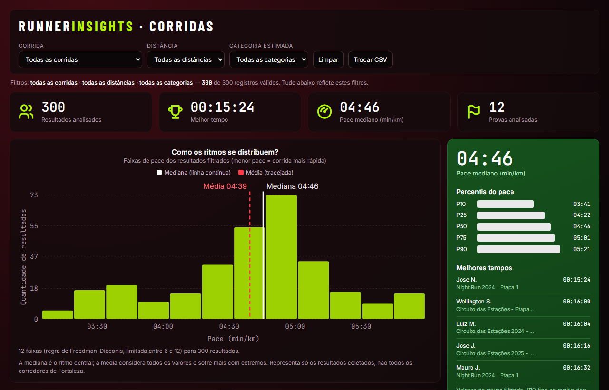
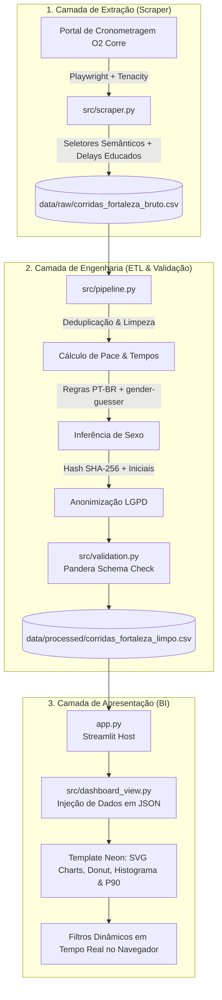

# 🏃‍♂️ RunnerInsights — Sports Analytics & Data Engineering Pipeline

[](https://www.python.org/)
[](https://streamlit.io/)
[](https://playwright.dev/)
[](tests/)
[](#-conformidade-ética-e-lgpd)
[](https://github.com/astral-sh/ruff)
[](LICENSE)

> **Pipeline analítico ponta a ponta de engenharia de dados e business intelligence esportivo**, coletando resultados de corridas de rua em Fortaleza (CE), tratando dados com conformidade estrita à LGPD e entregando inteligência estatística avançada em dashboard interativo.

---

### 💡 Destaques de Engenharia & Impacto
- **Contratos de Dados Rígidos:** 100% dos dados validados por schema declarativo com [Pandera](src/validation.py), impedindo corrupção analítica e rejeitando *paces* irreais (*fail-fast*).
- **Scraping Resiliente & Ético:** Extração assíncrona com [Playwright](src/scraper.py) lidando com SPAs dinâmicas, *exponential backoff* com [Tenacity](src/scraper.py) contra falhas transitórias de rede e conformidade com `robots.txt`.
- **Privacy by Design (LGPD):** Anonimização determinística de atletas via hash unidirecional `SHA-256(nome + url)` e pseudonimização de nomes, garantindo integridade referencial sem expor dados pessoais.
- **Sports Analytics Avançado:** Eliminação de distorções de *outliers* através de estatísticas robustas (**Mediana e Percentis P10–P90**) e gráficos de dispersão por gênero e prova.
- **Design System Documentado:** Interface esportiva Neon customizada com tokens de design e acessibilidade documentados em [docs/design_system.md](docs/design_system.md).
- **Engenharia de Software:** 56 testes automatizados com [Pytest](tests/) e linting estrito com [Ruff](pyproject.toml).

---

## 📸 Preview do Dashboard



---

## 🎯 Problema e Solução

### O Desafio
Resultados de provas de corrida amadora costumam ficar dispersos em portais de cronometragem que priorizam apenas a busca individual do atleta por número de peito. Não há visibilidade sobre:
- Como se distribuem os pelotões (Top 10%, Top 25%, mediana e retaguarda);
- Comparativos reais de ritmo (*pace*) entre diferentes edições e organizadores;
- Dispersão estatística por gênero e prova, livre da distorção de *outliers* ou abandonos.

### A Solução
O **RunnerInsights** implementa uma arquitetura modular moderna de dados:
1. **Coleta Resiliente:** Web scraper automatizado com Playwright que navega de forma estruturada, respeita o `robots.txt` e lida com instabilidades de rede via retry exponencial (`tenacity`).
2. **Pipeline de Dados & LGPD:** Higienização, deduplicação em memória, validação rigorosa de *schema* (`pandera`) e anonimização preventiva de atletas.
3. **Analytics Avançado:** Dashboard integrado com identidade visual esportiva Neon em alta performance, trazendo métricas robustas (mediana e percentis P10 a P90), histograma de ritmos com linhas estatísticas guia, comparativo de provas (Mediana vs P90) e proporção por gênero.

---

## 🏛️ Arquitetura do Projeto



---

## 🛠️ Stack Tecnológica & Decisões de Engenharia

| Tecnologia | Função no Projeto | Justificativa Técnica |
|---|---|---|
| **Python 3.11+** | Linguagem Principal | Tipagem estática moderna, ecossistema maduro para manipulação de dados. |
| **Playwright** | Web Scraping Headless | Suporte nativo a Single Page Applications (SPA/React/Next.js) e renderização assíncrona dinâmica do DOM. |
| **Tenacity** | Resiliência e Retry | Backoff exponencial configurável contra quedas de conexão e oscilações de Wi-Fi/rede. |
| **Pandas** | Processamento de Dados | Vetorização de alto desempenho para conversão de tempos, cálculos de *pace* e transformações tabulares. |
| **Pandera** | Validação de Schema | Garante a integridade estatística dos dados antes de salvar na base limpa (rejeita *paces* irreais ou dados corrompidos). |
| **gender-guesser** | Apoio Analítico | Complementa regras fonéticas do português brasileiro para enriquecimento estatístico com rotulação explícita de estimativa. |
| **Streamlit + SVG/HTML5** | Interface e Dashboard | Entrega ultrarrápida com design esportivo customizado, gráficos SVG e filtros instantâneos no cliente. |
| **Ruff** | Linting e Padronização | Linter ultrarrápido em Rust garantindo conformidade com PEP 8 e regras de qualidade de código. |
| **Pytest** | Testes Automatizados | Suíte completa com 56 testes unitários e de integração cobrindo scraper, pipeline, visualização e utilitários. |

---

## 📂 Estrutura do Repositório

```text
runner-insights/
├── .gitignore                   # Proteção de ambientes, caches e dados brutos
├── app.py                       # Ponto de entrada do dashboard (Streamlit)
├── pyproject.toml               # Configuração do projeto, Ruff e Pytest
├── requirements.txt             # Dependências principais de produção
├── requirements-dev.txt         # Dependências de desenvolvimento e testes
├── LICENSE                      # Licença MIT
├── README.md                    # Documentação do projeto
├── data/
│   ├── raw/                     # Dados brutos coletados pelo scraper
│   │   └── corridas_fortaleza_bruto.csv
│   └── processed/               # Dados tratados, validados e anonimizados
│       └── corridas_fortaleza_limpo.csv
├── docs/                        # Documentações técnicas e visuais
│   ├── dashboard_preview.png
│   └── design_system.md         # Tokens visuais, acessibilidade e componentes da UI
├── src/
│   ├── __init__.py
│   ├── config.py                # Configurações centrais, caminhos e variáveis de ambiente
│   ├── dashboard_view.py        # Serialização e renderização do dashboard Neon
│   ├── scraper.py               # Scraper resiliente com Playwright e Tenacity
│   ├── pipeline.py              # Pipeline ETL de limpeza, cálculo e anonimização
│   ├── templates/               # Templates HTML/CSS/JS da interface Neon
│   │   └── dashboard.html
│   ├── utils.py                 # Funções utilitárias (cálculo de pace, mediana e percentis)
│   └── validation.py            # Validação declarativa de schema com Pandera
└── tests/
    ├── test_dashboard_view.py   # Testes unitários do módulo de visualização
    ├── test_pipeline.py         # Testes unitários do pipeline e funções estatísticas
    ├── test_scraper.py          # Testes unitários e mocks do scraper resiliente
    └── test_validation.py       # Testes das regras de validação do schema Pandera
```

---

## ⚡ Instalação e Execução

### 1. Clonar o Repositório e Criar Ambiente Virtual

```bash
git clone https://github.com/fernandosvale/runner-insights.git
cd runner-insights

# Criar ambiente virtual
python -m venv .venv

# Ativar ambiente virtual (Windows PowerShell)
.\.venv\Scripts\Activate.ps1
# (Linux/macOS: source .venv/bin/activate)
```

### 2. Instalar Dependências

```bash
pip install -r requirements.txt -r requirements-dev.txt

# Instalar os binários do navegador Chromium para o Playwright
playwright install chromium
```

### 3. Executar a Suíte de Testes e Linter

```bash
# Rodar linter
ruff check .

# Executar todos os 54 testes unitários
pytest
```

### 4. Executar o Dashboard (com dados já incluídos)

O repositório já inclui uma base tratada e anonimizada para demonstração imediata:

```bash
streamlit run app.py
```
Acesse `http://localhost:8501` no navegador.

### 5. (Opcional) Executar Coleta e Pipeline do Zero

Caso queira re-extrair dados reais do portal:

```bash
# 1. Executar o scraper automatizado (coleta dados brutos)
python -m src.scraper

# 2. Executar o pipeline de tratamento e validação de schema
python -m src.pipeline
```

---

## 📊 Exemplo dos Dados Processados

Amostra representativa da base limpa em `data/processed/corridas_fortaleza_limpo.csv`:

| nome_prova | nome_atleta | sexo | tempo_bruto | distancia_km | pace_min_km | tempo_total_minutos | pace_decimal | id_atleta |
|---|---|---|---|---|---|---|---|---|
| Circuito das Estações - Inverno 2026 | Antonio F. | M | 00:16:55 | 5.0 | 03:23 | 16.92 | 3.38 | e8a129d891 |
| Circuito das Estações - Inverno 2026 | Arnaldo S. | M | 00:18:47 | 5.0 | 03:45 | 18.78 | 3.76 | d5b32f9104 |
| Circuito das Estações - Inverno 2026 | Washington L. | M | 00:19:18 | 5.0 | 03:52 | 19.30 | 3.86 | f9a419c820 |
| Circuito das Estações - Inverno 2026 | Cleudinei S. | N/I | 00:19:59 | 5.0 | 04:00 | 19.98 | 4.00 | a87c1264b3 |
| Circuito das Estações - Inverno 2026 | Antonio C. | M | 00:20:23 | 5.0 | 04:05 | 20.38 | 4.08 | b412fa0982 |

---

## 🔒 Conformidade Ética e LGPD

- **Privacidade por Design (LGPD):** Nomes completos são anonimizados no padrão `Primeiro S.` (primeiro nome + inicial do último sobrenome). Cada atleta recebe um identificador único via hash unidirecional truncado (`SHA-256(nome + url)`), garantindo rastreabilidade estatística sem exposição de dados pessoais.
- **Respeito ao `robots.txt`:** O scraper acessa estritamente a rota pública `/resultado/`, expressamente permitida nas regras do portal de cronometragem.
- **Polite Crawling:** São aplicados atrasos educados entre páginas (`1.0s`) e entre corridas (`1.5s`), além de um `User-Agent` transparente e identificável, evitando sobrecarga na infraestrutura de terceiros.

---

## 🗺️ Roadmap de Desenvolvimento

- [x] **Fase 0:** Higiene de repositório, `.gitignore` e anonimização LGPD.
- [x] **Fase 1:** Correção de ordenação de tempo numérico, cálculo de pace por distância, deduplicação e tratamento de exceções.
- [x] **Fase 2:** Adoção de boas práticas Streamlit (`st.cache_data`, `st.metric`) e fixação de dependências.
- [x] **Fase 3:** Modularização em `src/`, centralização de configurações em `src/config.py` e configuração do `ruff`.
- [x] **Fase 4:** Testes unitários com `pytest` e validação de schema de dados com `pandera`.
- [x] **Fase 5:** Robustez do scraper com seletores semânticos, eliminação de esperas cegas, retry via `tenacity` e validação do `robots.txt`.
- [x] **Fase 6:** Estatísticas com mediana, percentis (P10–P90), integração de `gender-guesser` e novos gráficos de dispersão (*boxplots* por gênero e por prova).
- [x] **Fase 8 (Antecipada):** Documentação completa do projeto, pré-visualização do dashboard, arquitetura Mermaid e licença MIT.
- [ ] **Fase 7 (Próxima):** Automação com GitHub Actions (CI para lint e testes), `pre-commit` hooks e script de orquestração.

---

## 📄 Licença

Este projeto é distribuído sob os termos da licença [MIT](LICENSE).
